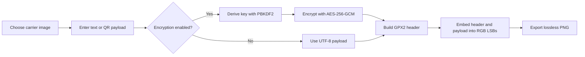
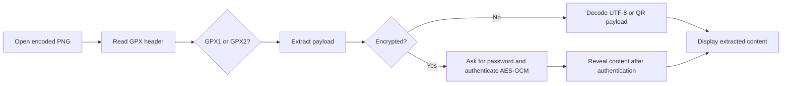

<h1 align="center"> Ghostpix</h1>

<p align="center"><a href="https://ghostpix.netlify.app"><strong>Open Ghostpix Live Demo ↗</strong></a></p>

<p align="center">

  <strong>Hide a secret in plain sight.</strong><br />

  A browser-based image steganography project for embedding text and QR image payloads inside ordinary pictures.

</p>

<p align="center">

  

  

  

  

</p>

<p align="center">

  <a href="#-overview">Overview</a> ·

  <a href="#-features">Features</a> ·

  <a href="#-how-it-works">How it works</a> ·

  <a href="#-security-model">Security</a> ·

  <a href="#-get-started">Get started</a> ·

  <a href="#-roadmap">Roadmap</a>

</p>

---

## ✦ Overview

**Ghostpix** lets you place a private payload inside an ordinary carrier image and later extract it with Ghostpix. It combines least-significant-bit (LSB) image steganography with optional password-based encryption, using browser APIs for image and cryptographic processing.

The current implementation supports:

- Unicode text, including Tamil and emoji.

- Text converted into a QR image payload.

- An uploaded QR image as the hidden payload.

- Password-protected payloads using AES-256-GCM.

- Lossless PNG export for preserving embedded pixel bits.

- Reading legacy GPX1 images as well as the current GPX2 format.

> **Project status:** Experimental / portfolio project. The implementation includes security controls and automated tests, but it has not undergone an independent cryptographic audit or formal penetration test. Do not use it as the sole protection for highly sensitive or safety-critical communications.

## ◈ Interface preview

<p align="center">
  
</p>
<p align="center"><sub>01 · Overview — desktop</sub></p>

<table>
  <tr>
    <td width="50%">
      
      <p align="center"><sub>02 · Step-by-step guide</sub></p>
    </td>
    <td width="50%">
      
      <p align="center"><sub>03 · Hide Vault — encoded image result</sub></p>
    </td>
  </tr>
  <tr>
    <td width="50%">
      
      <p align="center"><sub>04 · Hide result — dark theme</sub></p>
    </td>
    <td width="50%">
      
      <p align="center"><sub>05 · Overview — mobile</sub></p>
    </td>
  </tr>
</table>

### Mobile reveal previews

<table>
  <tr>
    <td width="33%">
      
      <p align="center"><sub>Reveal · Light</sub></p>
    </td>
    <td width="33%">
      
      <p align="center"><sub>Reveal · Dark</sub></p>
    </td>
    <td width="33%">
      
      <p align="center"><sub>How it works · Mobile</sub></p>
    </td>
  </tr>
</table>

## ✨ Features

| Area | What it does |
|---|---|
| **Hide Vault** | Select a carrier image, enter a message or QR payload, and embed the payload into image pixels. |
| **Reveal Inspector** | Load a Ghostpix PNG, inspect its header, extract the payload, and decrypt it when password-protected. |
| **Unicode** | Uses UTF-8 payload encoding for multilingual text and emoji. |
| **Encryption** | Password-protected mode uses AES-256-GCM with a 128-bit authentication tag. Encryption is enabled by default and can be switched off. |
| **Image capacity** | Estimates the carrier's payload capacity and blocks payloads that exceed it. |
| **QR payloads** | Generates a QR image from text or accepts an uploaded QR image for embedding. |
| **Pixel inspection** | Includes pixel/bit inspection and before/after comparison components. |
| **Legacy support** | The extractor supports the older GPX1 format as well as GPX2. |
| **Responsive interface** | Designed for desktop and smaller screens, with motion and reduced-motion handling. |

## ⌁ How it works

### Hide a message



### Reveal a message



## 🛡️ Security model

Ghostpix is designed to keep the image and message-processing workflow in the browser. Its security depends on both cryptography and the way the carrier image is handled after export.

### Encryption and key derivation

| Control | Current implementation |
|---|---|
| Cipher | AES-256-GCM |
| Authentication tag | 128-bit GCM tag |
| Password KDF | PBKDF2-HMAC-SHA-256 |
| GPX2 KDF work factor | 600,000 iterations by default |
| Legacy GPX1 KDF | 100,000 iterations for legacy encrypted payloads |
| Salt | 16 bytes, generated with `crypto.getRandomValues` |
| Nonce / IV | 12 bytes, generated with `crypto.getRandomValues` |
| Password rule | Minimum 8 characters, confirmation, and strength feedback |
| Metadata binding | GPX2 header fields are supplied as AES-GCM Additional Authenticated Data (AAD) |
AES-GCM authentication means that a wrong password or modified authenticated ciphertext/header metadata should cause decryption to fail rather than return unauthenticated plaintext.

### GPX2 and backward compatibility

| Property | GPX1 | GPX2 |
|---|---|---|
| Identifier | `GPX1` | `GPX2` |
| Header size | 9 bytes | 47 bytes |
| Header checksum | None | CRC-32 over the first 43 header bytes |
| Payload placement | Sequential | Password-seeded, pseudo-random Feistel mapping when encryption is enabled |
| KDF parameters | Legacy fixed behavior | KDF identifier and iteration count stored in the header |
| Extraction | Supported | Current format |
**Important implementation details and limitations:**

- The GPX2 header is written sequentially at the start of the RGB channel stream. Its `GPX2` marker is therefore recognizable; the header itself is not concealed.

- The current payload-position mapping uses a custom four-round, cycle-walking Feistel construction. It has not been independently reviewed as a cryptographic pseudorandom permutation. Treat it as an obfuscation/distribution mechanism, not as a substitute for encryption.

- The separate steganographic seed is currently derived with a default PBKDF2 work factor of 50,000 iterations, lower than the 600,000 iterations used for the AES encryption key. This mapping should receive independent cryptographic review before being relied on as a security boundary.

- LSB steganography is not inherently undetectable. Statistical steganalysis may identify altered pixel distributions even when the payload is encrypted.

- CRC-32 helps identify accidental/corrupt header changes; it is not a cryptographic authentication mechanism. AES-GCM provides the cryptographic authentication for encrypted payloads.

- Encryption can be turned off. In that mode, the payload is not confidential and should be treated as readable by anyone able to extract it.

### Image handling and limits

| Input | Limit / behavior |
|---|---|
| Carrier file size | Up to 50 MB |
| Carrier dimensions | Up to 16,384 px per side and 24 MP total |
| Accepted carrier formats | PNG, JPEG, WebP (validated by file signature and decoded image checks) |
| Export format | PNG |
| QR image upload | Up to 10 MB, 4,096 px per side and 4 MP total |
| QR text mode | Up to 2,331 UTF-8 bytes |
**Always share the exported PNG as a file/document.** Social platforms and messaging apps may resize, recompress, or convert images; that can destroy the hidden LSB data. Do not convert the exported PNG to JPEG.

### Privacy notes

- Image decoding, payload embedding/extraction, and encryption/decryption are implemented with browser-side Canvas and Web Crypto APIs.

- The project has no application backend, account system, or API key requirement in the current source.

- The app stores the visual theme preference in `localStorage`; secret messages and passwords are handled in transient application state and are not intentionally persisted there.

- Google Fonts are loaded from Google Fonts, so the page makes external font requests. The app is therefore not completely offline by default.

- Browser extensions, compromised devices, screenshots, clipboard managers, and recipients saving a decoded message are outside Ghostpix's protection boundary.

## ⚙️ Tech stack

| Technology | Role |
|---|---|
| React 19 | UI and component state |
| TypeScript | Application and utility logic |
| Vite | Development server and production bundler |
| Tailwind CSS 4 | Styling system |
| Web Crypto API | AES-GCM and PBKDF2 |
| Canvas 2D API | Pixel access and lossless PNG generation |
| `qrcode` | QR image generation |
| `jsqr` | QR decoding |
| Motion / GSAP | Interface animation |
| `tsx` + Node test runner | Utility test execution |

## 🚀 Get started

### Requirements

- Node.js 18 or newer (a current LTS release is recommended).

- npm.

- A modern browser with Canvas 2D and Web Crypto support.

### 1. Clone the repository

```bash

git clone https://github.com/YOUR_USERNAME/ghostpix.git

cd ghostpix

```

Replace `YOUR_USERNAME` with your GitHub username, and adjust `ghostpix` if you chose a different repository name.

### 2. Install dependencies

```bash

npm install

```

### 3. Start the development server

```bash

npm run dev

```

Open the local URL printed by Vite (the project script uses port `3000`).

### 4. Run checks

```bash

# Run the automated utility tests

npm test

# Run TypeScript type checking (the script is named lint)

npm run lint

# Create a production build

npm run build

# Preview the production build locally

npm run preview

```

> `npm run lint` currently runs `tsc --noEmit`; it is a TypeScript check, not an ESLint rule scan.

## 🌐 Deploy

Ghostpix is a static Vite application and can be hosted on Netlify, Vercel, or another static web host.

Live website: https://ghostpix.netlify.app

**Build settings**

| Setting | Value |
|---|---|
| Build command | `npm run build` |
| Publish directory | `dist` |
| Environment variables | None required by the current source |
For production, configure security headers at the hosting provider as HTTP response headers. The current `index.html` contains a meta CSP directive; review and tighten its `unsafe-inline` allowances and external font origins as part of deployment hardening.

## 🧪 Test coverage in the repository

The current utility test suite includes checks for:

- GPX2 capacity calculations and GPX1 compatibility.

- Unicode (Tamil and emoji) encode/extract round trips.

- AES-GCM encryption, wrong-password rejection, ciphertext tampering, and AAD tampering.

- Feistel permutation bijection properties.

- Password strength rules.

- Image format, dimension, size, and PNG structure validation.

- Capacity overflow and empty payload handling.

- QR generation and QR size limits.

- Pixel inspection and PNG pixel round trips.

- PBKDF2 performance benchmarks.

Run `npm test` locally to execute the suite. Test coverage listed here describes the test cases present in the source; it is not a claim that every browser, device, or deployment environment has been tested.

## 🗂️ Project structure

```text
ghostpix/
├── docs/
│   └── screenshots/
│       ├── ghostpix-overview-desktop.png
│       ├── ghostpix-how-to-use-desktop.png
│       ├── ghostpix-hide-vault-result.png
│       ├── ghostpix-hide-result-dark.jpg
│       ├── ghostpix-overview-mobile.png
│       ├── ghostpix-reveal-mobile-light.png
│       ├── ghostpix-reveal-mobile-dark.png
│       └── ghostpix-how-it-works-mobile.png
├── src/
│   ├── assets/images/          # Built-in sample carrier images
│   ├── components/             # Hide, reveal, UI and diagnostics components
│   ├── utils/
│   │   ├── canvasHelpers.ts    # Image validation and Canvas operations
│   │   ├── crypto.ts           # AES-GCM and PBKDF2 helpers
│   │   ├── qrStego.ts          # QR payload utilities
│   │   ├── steganography.ts    # GPX1 / GPX2 LSB encoding and extraction
│   │   └── steganography.test.ts
│   ├── App.tsx
│   ├── index.css
│   └── main.tsx
├── .gitignore
├── bun.lock
├── index.html
├── package.json
├── tsconfig.json
└── vite.config.ts
```

## 🧭 Roadmap

These are ideas for future work, not features promised by the current release.

- [ ] Independent cryptographic review of the GPX2 payload-position permutation.

- [ ] Evaluate stronger memory-hard password derivation for supported browsers.

- [ ] Reduce the recognizable GPX2 header footprint in a future format revision.

- [ ] Add end-to-end browser tests across desktop and mobile browsers.

- [ ] Review and tighten production CSP and HTTP security headers.

- [ ] Add reproducible steganalysis evaluation and publish measured results.

- [ ] Explore offline-first PWA support.

## 🤝 Contributing

Contributions, bug reports, and security feedback are welcome. For code changes:

1. Fork the repository.

2. Create a focused branch.

3. Include or update tests for behavior changes.

4. Run `npm test`, `npm run lint`, and `npm run build`.

5. Open a pull request with a clear summary and test results.

Please do not publish details of an unpatched security issue in a public issue. Contact the maintainer privately where possible.

## 📜 License

No `LICENSE` file is included in the current project source. Add a license before granting others explicit permission to reuse, modify, or redistribute the project.

---

<p align="center">

  <strong>Ghostpix</strong><br />

  <sub>Privacy is a design choice. Security is a process.</sub>

</p>
