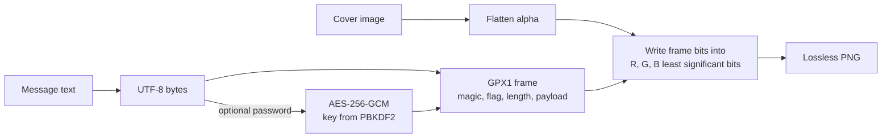
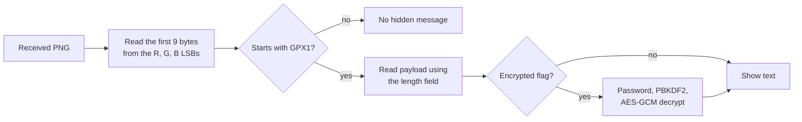

<div align="center">
# Ghost_pix
 
### Hide a secret in plain sight.
 
Hide a Unicode message, optionally locked with a password, inside an ordinary image.
Send the picture. Your friend opens it in Ghost_pix and reads the message.
**Everything runs in your browser. Nothing is uploaded.**
 


 

</div>
---
 
## Contents
 
- [What it does](#what-it-does)
- [Screenshots](#screenshots)
- [Features](#features)
- [How it works](#how-it-works)
- [Quick start](#quick-start)
- [Using the app](#using-the-app)
- [Project structure](#project-structure)
- [Tech stack](#tech-stack)
- [Limitations (please read)](#limitations-please-read)
- [Roadmap](#roadmap)
- [Author](#author)
---
 
## What it does
 
Ghost_pix is a **steganography** web app. It changes the least significant bit of a few colour values in a picture, so that the picture still looks identical to the eye but now carries a hidden message.
 
| You want to… | Ghost_pix… |
| --- | --- |
| Send a private note inside a normal-looking photo | Hides it in the image and gives you a lossless PNG |
| Keep the note unreadable even if someone finds it | Locks it with AES-256-GCM and your password before hiding |
| Read a hidden note you received | Detects it, asks for the password if needed, and shows the text |
| Understand what changed in the picture | Shows a before/after slider and a pixel-level bit inspector |
 
---
 
## Screenshots
 
<table>
  <tr>
    <td width="50%"><br><sub><b>Hide Vault.</b> Pick a cover image, type the message, set an optional password.</sub></td>
    <td width="50%"><br><sub><b>Result.</b> Before/after slider with bits embedded, LSBs flipped and pixels modified.</sub></td>
  </tr>
  <tr>
    <td width="50%"><br><sub><b>Bit inspector.</b> An 8×8 pixel block with the exact binary change for every channel.</sub></td>
    <td width="50%"><br><sub><b>Reveal.</b> GPX1 is detected, the password unlocks the message, one click copies it.</sub></td>
  </tr>
</table>
---
 
## Features
 
**Hiding and revealing**
- Hide any UTF-8 text, including emoji and non-Latin scripts such as Tamil
- Optional **AES-256-GCM** encryption with a password (PBKDF2-SHA256, random salt and IV per message)
- **QR mode**: the message is rendered as a QR code PNG and that PNG is hidden in the carrier (up to 2,331 UTF-8 bytes)
- Output is always a **lossless PNG**, so every hidden bit survives
- Reveal side pre-scans the upload and tells you whether a GPX1 message exists, and whether it needs a password
**Understanding what happened**
- Before/after comparison slider with an adjustable split
- **Bit view inspector**: pick any pixel in an 8×8 block and see its R, G, B values and the changed bit in binary
- Live **capacity meter** so you know how much text fits before you press the button
- **Security audit panel** on the reveal page: header signature, format integrity, Shannon entropy and payload capacity
**Convenience**
- Drag and drop, file picker, or paste an image with `Ctrl+V`
- Two built-in sample images (Aurora Fjord and Glass Prisms) to try it without your own photo
- Accepts PNG, JPEG and WebP up to 24 megapixels, with a notice above 8 megapixels
- Warns you that chat apps recompress images and will destroy the message (send as **File** or **Document**)
- Light and dark themes (follows your system setting, with a toggle)
- Respects the reduced-motion setting
**Privacy**
- No server, no account, no upload. Images and messages are processed with the browser's Canvas and Web Crypto APIs
---
 
## How it works
 

 

 
### The idea in one pixel
 
Every pixel has red, green and blue values from 0 to 255. Changing the **last bit** of a value moves it by at most 1/255 (0.39 percent), which nobody can see. Ghost_pix writes the message into those last bits, three bits per pixel.
 
The first byte of every message is the letter `G` (`0x47`, binary `01000111`). Its first three bits `0`, `1`, `0` are written into the first pixel. This is a real capture from the bit inspector:
 
| Channel | Before | After | Last bit |
| --- | --- | --- | --- |
| R | `3` (`00000011`) | `2` (`00000010`) | `1` → `0` |
| G | `12` (`00001100`) | `13` (`00001101`) | `0` → `1` |
| B | `21` (`00010101`) | `20` (`00010100`) | `1` → `0` |
 
### The GPX1 frame
 
Everything hidden in an image is wrapped in this frame, written most significant bit first, starting at pixel 0:
 
| Offset | Size | Field | Meaning |
| --- | --- | --- | --- |
| 0 | 4 bytes | Magic | `GPX1` (`47 50 58 31`) |
| 4 | 1 byte | Flags | `0x01` encrypted, `0x02` payload is a QR PNG, `0x03` both |
| 5 | 4 bytes | Length | Payload length, unsigned 32-bit, big-endian |
| 9 | length bytes | Payload | UTF-8 text, an encrypted blob, or a QR PNG |
 
When encrypted, the payload is `[16-byte salt | 12-byte IV | ciphertext + 16-byte GCM tag]`, which adds 44 bytes of overhead.
 
### Capacity
 
```
capacity (bytes) = floor(width × height × 3 / 8) − 9
```
 
A 1200 × 896 image holds 403,191 bytes. Alpha is not used, and transparent pixels are flattened before embedding.
 
---
 
## Quick start
 
**You need:** Node.js 20.19 or newer (or 22.12 or newer), and npm.
 
Clone this repository, then from the project root:
 
```bash
npm install --legacy-peer-deps
npm run dev
```
 
Open **http://localhost:3000**.
 
> `--legacy-peer-deps` is currently needed because of a peer-dependency conflict in the dependency tree. See [Roadmap](#roadmap).
 
| Command | What it does |
| --- | --- |
| `npm run dev` | Start the dev server on port 3000 |
| `npm run build` | Create a production build in `dist/` |
| `npm run preview` | Serve the production build locally |
| `npm run lint` | Type-check with `tsc --noEmit` |
| `npx tsx --test src/utils/steganography.test.ts` | Run the 12 unit tests |
 
The app uses hash routes, so any static host works with no server rules:
 
| Route | Page |
| --- | --- |
| `#/` | Home |
| `#/hide-vault` | Hide a message |
| `#/reveal-inspector` | Reveal a message |
 
---
 
## Using the app
 
### Hide a message
 
1. Open **Hide Vault**.
2. Drop, paste or choose a cover image, or pick one of the samples.
3. Type your message. The capacity meter shows how much room is left.
4. Optional: set a password to encrypt the message, or use QR mode.
5. Press **Hide Message**.
6. Check the before/after slider and the bit inspector, then press **Download PNG**.
7. Send the PNG as a **file or document**. Photo mode in WhatsApp, Instagram and Telegram recompresses it and destroys the message.
 
### Reveal a message
 
1. Open **Reveal Inspector** (or press **Verify in Reveal** after hiding).
2. Drop the PNG you received.
3. The banner shows whether a GPX1 message was found and whether it is locked.
4. Enter the password if the sender set one.
5. Press **Reveal Message**, then **Copy** if you want the text.
---
 
## Project structure
 
```
.
├── index.html                  Page shell, fonts, social metadata
├── metadata.json               App name and description
├── vite.config.ts              Vite + React + Tailwind plugins
├── public/
└── src/
    ├── main.tsx                Entry point
    ├── App.tsx                 Hash router, page layout, shared state
    ├── index.css               Tailwind 4 theme and custom styles
    ├── assets/images/          Two sample cover images
    ├── components/
    │   ├── HideWorkspace.tsx       Hide page: input, options, result
    │   ├── RevealWorkspace.tsx     Reveal page: pre-scan, password, output
    │   ├── DropZone.tsx            Drag/drop, picker, paste, samples
    │   ├── BeforeAfterSlider.tsx   Comparison slider
    │   ├── BitViewInspector.tsx    8×8 LSB grid with binary diff
    │   ├── CapacityMeter.tsx       Remaining-space indicator
    │   ├── SecurityAuditPanel.tsx  Header, format and entropy readout
    │   ├── HowItWorks.tsx          Three-step explainer
    │   ├── StepByStepGuide.tsx     Usage guide
    │   └── TopBar, ScrollScaleRail, LiquidGlassPanel,
    │       AuroraBackground, ScrambleRevealText, SuccessBurst   UI polish
    └── utils/
        ├── steganography.ts        GPX1 frame, embed, extract, capacity
        ├── crypto.ts               AES-256-GCM + PBKDF2 (Web Crypto)
        ├── qrStego.ts              Message → QR PNG, and QR decode
        ├── canvasHelpers.ts        Image loading, size caps, PNG export
        └── steganography.test.ts   Unit tests (node:test)
```
 
---
 
## Tech stack
 
| Area | Tools |
| --- | --- |
| UI | React 19, TypeScript 7 |
| Build | Vite 8 |
| Styling | Tailwind CSS 4, Chakra Petch, JetBrains Mono, Plus Jakarta Sans |
| Motion | motion, GSAP |
| Icons | lucide-react |
| QR | `qrcode` (encode), `jsQR` (decode) |
| Crypto | Web Crypto API (AES-GCM, PBKDF2) |
| Tests | Node's built-in test runner, run through `tsx` |
 
---
 
## Limitations (please read)
 
Ghost_pix is a learning and demo project. It has not had an independent security review, so do not rely on it for anything where a leak would cause serious harm.
 
- **It does not survive recompression.** Resizing, screenshots, JPEG conversion, and chat apps in photo mode all destroy the message. Always send the PNG as a file.
- **Encryption hides the content, not the fact that a message exists.** The `GPX1` signature is stored unencrypted, so anyone who knows the format can see that the image carries a Ghost_pix message.
- **LSB hiding can be detected statistically.** Messages are written sequentially from the first pixel. Filling a large share of the image's capacity makes it easier for steganalysis tools to flag. Short messages in large images are the safest.
- **Password strength matters.** Keys come from PBKDF2-SHA256 with 100,000 iterations, which is below the 600,000 that the [OWASP Password Storage Cheat Sheet](https://cheatsheetseries.owasp.org/cheatsheets/Password_Storage_Cheat_Sheet.html) recommends for that algorithm. Use a long passphrase.
- **Fonts load from Google Fonts.** Your images and messages never leave the device, but the page itself requests fonts from Google when it opens.
- **Large images use a lot of memory.** Images above 24 megapixels are rejected.
---
 
## Roadmap
 
- [ ] Remove unused dependencies (`express`, `dotenv`, `@google/genai`, `autoprefixer`, `esbuild`) and drop the need for `--legacy-peer-deps`
- [ ] Add an `npm test` script and run the tests in CI
- [ ] Raise the PBKDF2 iteration count and store a format version so old images still open
- [ ] Spread the message across the image with a password-derived pixel order instead of writing sequentially
- [ ] Self-host the fonts so the page makes no third-party requests
- [ ] Add a licence file
---
 
## Author
 
Built by **Pranesh U K**, final-year Computer Science Engineering student, UI/UX and frontend.
 
---
 
<div align="center">
<sub>Ghost_pix · client-side steganography · all canvas and Web Crypto operations stay on your device</sub>
</div>
 
